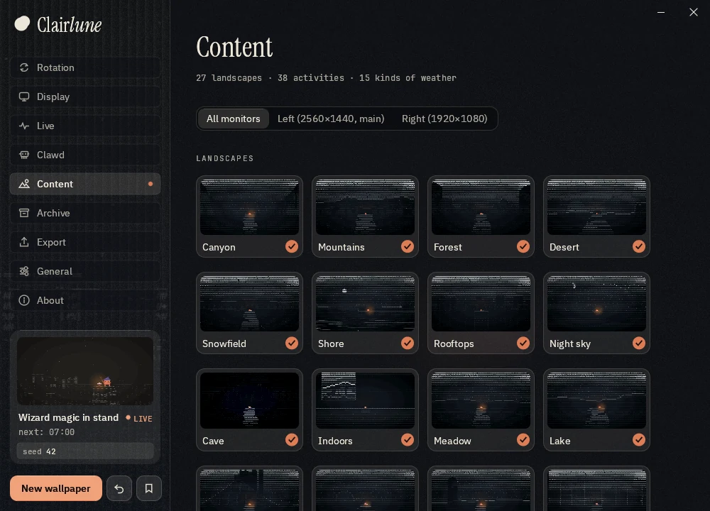

# Clairlune

[](https://github.com/yam333/Clairlune/actions/workflows/ci.yml)
[](https://github.com/yam333/Clairlune/releases/latest)
[](https://crates.io/crates/clairlune)
[](#license)


Procedural, animated ASCII-art wallpapers for Windows and macOS, written in Rust.

[](https://github.com/yam333/Clairlune/releases/download/v0.28.0/clairlune-trailer.mp4)

Each wallpaper is a landscape drawn in text characters, with a small pixel-art Clawd doing something in it and a few things moving: embers, snow, stars. Everything is generated on your computer from a seed, and the same seed gives the same picture everywhere. There's no AI, and nothing about you goes online.


> **Unofficial fan project.** Not affiliated with or endorsed by Anthropic. Clawd is Anthropic's character.

**[Download](https://github.com/yam333/Clairlune/releases/latest)** · [User guide](docs/guide.md) · [Command-line tool](docs/cli.md) · [Changelog](CHANGELOG.md)

## Features

- **27 landscapes, 38 activities, 15 kinds of weather**, in line art or a dithered look, from canyons and snowfields to a wizard's tower and a lake of floating lanterns.
- **Live wallpapers** that play behind the desktop icons and pause under full-screen apps, on battery if you like, and while the screen is locked.
- **A scene for each monitor**, at its own resolution, or one wide scene across all of them.
- **Seeds that mean something:** copy a wallpaper's seed and type it in later to get the same wallpaper back.
- **An archive, a library and a timeline:** the last week of wallpapers, the ones you keep for good, and a plan for each day.
- **Light, dark or following the sun**, worked out on your computer.
- **Self-updating**, with every download checked against GitHub's checksum. The once-a-day check can be turned off.



## Install

- **Windows 10/11:** `clairlune_<version>_x64-setup.exe` from the [latest release](https://github.com/yam333/Clairlune/releases/latest). It installs for your account, with no admin rights. Or `scoop bucket add clairlune https://github.com/yam333/homebrew-clairlune` then `scoop install clairlune`.
- **macOS 13+:** paste this into Terminal. It downloads the latest release, checks it against the release's checksum and opens it ([what it does](install.sh)):

  ```sh
  curl -fsSL https://raw.githubusercontent.com/yam333/Clairlune/main/install.sh | sh
  ```

  Or `Clairlune_<version>_aarch64.dmg` (Apple Silicon) or `_x64.dmg` (Intel) from the [latest release](https://github.com/yam333/Clairlune/releases/latest), or `brew install --cask yam333/clairlune/clairlune`. macOS blocks these the first time: click **Done** (not Move to Trash), then **Open Anyway** at the bottom of System Settings > Privacy & Security.
- **Linux:** the command-line tool only: `cargo install clairlune-cli`.

winget, building from source and removing Clairlune are covered in the [user guide](docs/guide.md#install). Clairlune lives in the notification area (Windows) or the menu bar (macOS) as a square over a circle. The [guide](docs/guide.md) covers everything in Settings.

## Command-line tool

`clairlune-cli` renders the same scenes without the app, on Windows, macOS and Linux:

```sh
cargo install clairlune-cli
clairlune-cli generate --seed 7 --theme dark --size 3840x2160 --out wallpaper.png
clairlune-cli gif --seed 7 --activity warm_hands --size 960x540 --out campfire.gif
```

Every command and flag is in [docs/cli.md](docs/cli.md).

## Building from source

The app needs Rust 1.95 or newer (the libraries and the CLI, 1.90) and builds on Windows and macOS. Everything but the app also builds on Linux.

```sh
cargo run --release -p clairlune                                   # the app
cargo run --release -p clairlune-cli -- generate --seed 7 --out wallpaper.png
cargo test --workspace                                             # unit, property and golden tests
```

The [justfile](justfile) has the common tasks: sprite export and checks, re-blessing the golden images, the performance check.

## How it's built

Generation is pure and deterministic: a seed becomes a recipe, the recipe a scene graph, the graph frames of palette indices. The same inputs give byte-identical output on every platform, and CI checks that with golden images on Windows, macOS and Linux.

| Crate | Purpose |
|---|---|
| [`clairlune-scene`](crates/scene) | Seed → recipe → scene graph. No I/O, no clocks. |
| [`clairlune-render`](crates/render) | Glyph atlas, palette-index compositor, PNG and GIF export, frozen scene packages. |
| [`clairlune-sprites`](crates/sprites) | Aseprite sheet loader and the character rig. |
| [`clairlune-live`](crates/live) | Live playback behind the desktop icons, uploading only what changed. |
| [`clairlune-platform`](crates/platform) | Monitors, wallpapers, login items, system theme. |
| [`clairlune-cli`](crates/cli) | The command-line tool. |
| [`clairlune`](crates/app) | The tray app and its windows (egui). |

Design notes, the activity system and the art rules are in [docs/dev](docs/dev).

## Contributing

Bug reports and ideas are welcome: [open an issue](https://github.com/yam333/Clairlune/issues/new/choose). The app's Settings -> General -> Report a problem fills one in for you. For code, see [CONTRIBUTING.md](CONTRIBUTING.md).

## Generated images

With Clawd turned on, wallpapers contain fan art of Anthropic's character, so take care if you publish or sell them. Images made with `--no-buddy` contain only this project's own work.

## License

Code: [MIT](LICENSE-MIT) or [Apache-2.0](LICENSE-APACHE), at your option.

The bundled fonts, JetBrains Mono, IBM Plex Sans and Instrument Serif, are under the SIL Open Font License 1.1 ([JetBrains Mono](crates/render/assets/fonts/OFL.txt), [IBM Plex Sans](crates/app/assets/fonts/OFL.txt), [Instrument Serif](crates/app/assets/fonts/InstrumentSerif-OFL.txt)). The Clawd artwork is fan art and isn't covered by the code licence; see [NOTICE](NOTICE).
