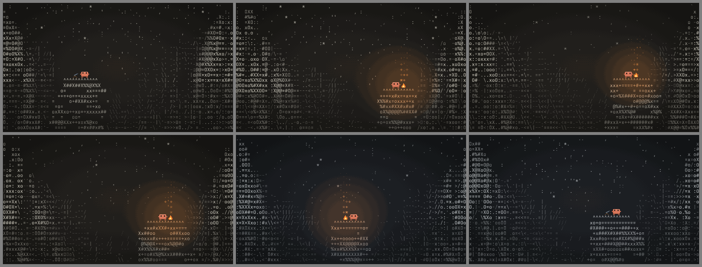

# Clairlune

Procedural, animated ASCII-art desktop wallpapers, written in Rust.

Every wallpaper is generated locally from a seed: a landscape built from text glyphs, a small pixel-art buddy doing something in it, and a few animated details such as embers, snow or stars. Generation is deterministic, so the same seed gives the same picture on every computer. There is no AI and no network access at runtime.



> **Unofficial fan project.** Not affiliated with or endorsed by Anthropic. Clawd is Anthropic's character.

## Status

Early development. Milestone M1 is the headless generator and a developer CLI that renders a still PNG. The desktop app (tray, settings, live wallpapers) comes in later milestones; see [PLAN.md](PLAN.md).

## Try the generator

```sh
cargo run --release -p clairlune-cli -- generate --seed 7 --theme dark --size 3840x2160 --out wallpaper.png
```

Options:

| Flag | Meaning |
|---|---|
| `--seed <u64>` | Scene seed. Omit it to get a random one (printed). |
| `--theme light\|dark` | Palette and time of day. |
| `--size <W>x<H>` | Output size in pixels. |
| `--out <path>` | Output PNG (indexed, at most 255 colours). |
| `--activity <id>` | Force an activity: `warm_hands`, `stroll`, `stargaze` (night only). |
| `--no-buddy` | Render the same scene without the character. |
| `--recipe-out <path>` | Also write the scene recipe as JSON. |
| `--time-ms <t>` | Render a specific animation time instead of the hero frame. |

To check variety, render many seeds into one grid:

```sh
clairlune-cli contact-sheet --count 12 --theme dark --out sheet.png
clairlune-cli contact-sheet --activity stroll --count 8 --out strolls.png
```

## Workspace

| Crate | Purpose |
|---|---|
| `clairlune-scene` (`crates/scene`) | Pure, deterministic: seed → recipe → scene graph. No I/O. |
| `clairlune-sprites` (`crates/sprites`) | Aseprite sheet loader, anchors, the `Character` trait. |
| `clairlune-render` (`crates/render`) | Glyph atlas, palette-index compositor, PNG export. |
| `clairlune-cli` (`crates/cli`) | Developer tool. |
| `clairlune` (`crates/app`) | The desktop app (placeholder until milestone M6). |

## Generated images

With the buddy turned on, wallpapers contain a drawing of Clawd, which is Anthropic's character. If you publish or sell generated images, that is fan art and the same caution applies. With `--no-buddy`, images contain only this project's own content.

## License

Code: either of [MIT](LICENSE-MIT) or [Apache-2.0](LICENSE-APACHE), at your option.

The bundled JetBrains Mono font is under the [SIL Open Font License 1.1](crates/render/assets/fonts/OFL.txt).

Clawd artwork is fan art and is **not** covered by the code licence. See [NOTICE](NOTICE).
