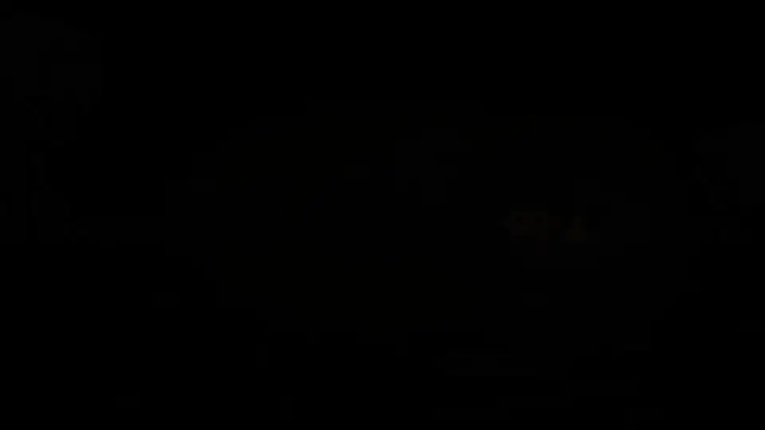

# Clairlune

Procedural, animated ASCII-art desktop wallpapers, written in Rust.

[](docs/media/trailer.mp4)


Each wallpaper is a landscape made of text characters, with a small pixel-art Clawd doing something in it and a few things moving: embers, snow, stars. Everything is generated on your computer from a seed, and the same seed gives the same picture everywhere. There's no AI and nothing about you goes online: Clairlune checks GitHub once a day for a newer version (you can turn that off in Settings -> General), and downloads one only when you click Update now.


> **Unofficial fan project.** Not affiliated with or endorsed by Anthropic. Clawd is Anthropic's character.

**[Download](https://github.com/yam333/Clairlune/releases/latest)** · [User guide](docs/guide.md) · [Changelog](CHANGELOG.md)

## Status

Usable every day on Windows and macOS, where the tray or menu bar app is the main way to use it. There's no Linux app; on Linux, `clairlune-cli` renders the same scenes as PNGs and GIFs. There are twenty-seven landscapes (from canyons and snowfields to a volcano, palm islands, a waterfall, old ruins and the Moon, and magical ones: giant mushrooms, a crystal cave, a great tree hung with lanterns, a wizard's tower, a ring of standing stones and a lake of floating lanterns), thirty-eight things Clawd can be doing, fifteen kinds of weather (petals, fog, blizzards, falling ash, birds, butterflies and shooting stars among them), and two looks: line art, or a dithered version built from dots and bars. Seven of the activities are journeys, where the land in front scrolls past a big still landmark (a dome, a peak, a volcano, a mesa, a rising moon): a ridge hike, ski touring, sledding, a forest walk, a desert trek, and flights on the broom or in the balloon. The roadmap is in [PLAN.md](PLAN.md).

## Install

Get the installer for your system from the [Releases](https://github.com/yam333/Clairlune/releases) page:

- Windows: `clairlune_<version>_x64-setup.exe`. It installs for your account only, so it doesn't need administrator rights. Uninstall it from Settings > Apps.
- macOS: `Clairlune_<version>_aarch64.dmg` (Apple Silicon) or `Clairlune_<version>_x64.dmg` (Intel). Drag Clairlune to Applications. The app isn't notarized, so macOS refuses to open it the first time; go to System Settings > Privacy & Security and click Open Anyway.
- Linux: no desktop app (0.18.0 was the last, never tried on a real Linux desktop). `cargo install clairlune-cli` makes the wallpapers as images to set yourself (see [the command-line tool](#the-command-line-tool)).

Or use a package manager:

- Homebrew: `brew install --cask yam333/clairlune/clairlune`
- Scoop: `scoop bucket add clairlune https://github.com/yam333/homebrew-clairlune`, then `scoop install clairlune`
- winget: see [below](#winget)
- Cargo: `cargo install clairlune`, or `cargo install --path crates/app` from a checkout

Clairlune lives in the notification area (Windows) or the menu bar (macOS) as a moon icon. The first time you open it, it asks whether to start quietly when you sign in.

### winget

Clairlune isn't in winget's catalog yet: the package is waiting for Microsoft's review. Once it's in, installing is one command:

```powershell
winget install Clairlune.Clairlune
```

Until then, winget can install it from the manifest files attached to each release (`clairlune_<version>_winget.zip`). winget only installs from local manifests once they're allowed, so first, in a Terminal opened as administrator (once per PC):

```powershell
winget settings --enable LocalManifestFiles
```

Then, in a normal Terminal, fetch the latest release's manifests and install:

```powershell
$r = Invoke-RestMethod https://api.github.com/repos/yam333/Clairlune/releases/latest
$a = $r.assets | Where-Object name -like '*_winget.zip'
Invoke-WebRequest $a.browser_download_url -OutFile "$env:TEMP\clairlune-winget.zip"
Expand-Archive "$env:TEMP\clairlune-winget.zip" "$env:TEMP\clairlune-winget" -Force
winget install --manifest "$env:TEMP\clairlune-winget"
```

winget downloads the setup.exe from the release, checks it against the SHA-256 in the manifest and installs it for your account. Installed this way, `winget upgrade` doesn't know about it; Clairlune updates itself (Settings -> General -> Update now). You can turn the setting back off afterwards with `winget settings --disable LocalManifestFiles` (as administrator).

## Using the app

It sets a new wallpaper when it starts and then every hour, with a separate scene on each monitor. By default the scene plays live behind your desktop icons, and it pauses on a monitor while a maximized or full-screen app covers it. Settings -> Display switches to a still frame; Settings -> Live sets the frame rate (6 to 60 a second, 12 by default).

On Windows, double-click the moon to open Settings and right-click it for the menu. From the menu you can get a new wallpaper (on every monitor, or just one), go back to the previous one, switch theme, pause the changes, save the current wallpaper as a PNG or GIF, and open the Archive, Library and Timeline windows.

The Archive keeps the last week of wallpapers so you can reuse, pin or export them. Save to library keeps one for good; it's stored as a frozen scene, so it looks the same after updates. With Settings -> Rotation set to Timeline, the app follows a daily plan instead of the hourly change: drag saved wallpapers or random scenes onto a 24-hour bar for each day, and pick each slot's theme.

Settings also covers which landscapes, activities and weather to use, the look and contrast, the zoom (Clawd up close, smaller, or tiny in a huge landscape), Clawd on or off, start at login, hiding the moon icon (open Clairlune again to get back to Settings), and Restore my wallpaper, which puts back the wallpaper you had before Clairlune. With more than one monitor, each can keep the still frame while the others play live (Display), or pick from its own landscapes and activities (Content).

When a newer version is out, Settings -> General and the menu offer it: Update now downloads it from GitHub, checks it against the checksum GitHub lists, installs it and starts Clairlune again (installs from Scoop or cargo update the usual way instead). Report a problem, next to it, opens a new GitHub issue with the version, system, monitors and recent log lines filled in; you see them in Settings first, and nothing is sent until you send the issue. Settings live in `%APPDATA%\clairlune\settings.toml` and logs in `%LOCALAPPDATA%\clairlune\logs`.

## The command-line tool

`clairlune-cli` renders wallpapers without the app, on Windows, macOS and Linux (`cargo install clairlune-cli`):

```sh
cargo run --release -p clairlune-cli -- generate --seed 7 --theme dark --size 3840x2160 --out wallpaper.png
```

| Flag | Meaning |
|---|---|
| `--seed <u64>` | Scene seed. Leave it out for a random one (printed). |
| `--theme light\|dark` | Palette and time of day. |
| `--size <W>x<H>` | Output size in pixels. |
| `--out <path>` | Output PNG (indexed, at most 255 colours). |
| `--activity <id>` | Force an activity, such as `stroll` or `hike_ridge`. An unknown id lists them all. |
| `--archetype <id>` | Force a landscape: `canyon`, `mountains`, `forest`, `desert`, `snowfield`, `shore`, `city_rooftops`, `night_sky`, `cave`, `interior`, `meadow`, `lake`, `volcano`, `islands`, `lunar`, `bamboo`, `waterfall`, `countryside`, `ruins`, `savanna`, `swamp`, `mushrooms`, `crystals`, `great_tree`, `wizard_tower`, `standing_stones`, `lantern_lake`. |
| `--weather <id>` | Force the weather where the scene allows it, such as `rain`, `fog`, `birds`, `butterflies`, `seeds` or `shooting_stars`. An unknown id lists them all. |
| `--look <look>` | `line` or `dither`. |
| `--contrast <c>` | `soft`, `normal`, `high`, or `vary` (one per seed). |
| `--no-buddy` | The same scene without Clawd. |
| `--recipe-out <path>` | Also write the scene recipe as JSON. |
| `--time-ms <t>` | Render a given moment instead of the default frame. |

A looping GIF, 6 or 12 seconds long (`--smoothness battery-saver|balanced|smooth|very-smooth|ultra-smooth`):

```sh
clairlune-cli gif --seed 7 --activity warm_hands --size 960x540 --out campfire.gif
```

A frozen scene package holds everything a scene needs to play, about 0.5-1 MB at 4K, and it plays the same after the generator changes:

```sh
clairlune-cli package --seed 7 --size 1920x1080 --out scene7       # freeze a scene
clairlune-cli generate --package scene7 --theme light --out still.png
clairlune-cli gif --package scene7 --out scene7.gif
```

Many seeds in one grid, to check variety:

```sh
clairlune-cli contact-sheet --count 12 --theme dark --out sheet.png
clairlune-cli contact-sheet --activity stroll --count 8 --out strolls.png
clairlune-cli contact-sheet --archetype shore --count 6 --theme light --out shores.png
```

Set wallpapers directly (Windows):

```sh
clairlune-cli monitors                 # ids, physical sizes, current wallpapers
clairlune-cli set --seed 7             # one scene per monitor, at each monitor's resolution
clairlune-cli set --archetype shore --theme light
clairlune-cli restore                  # put back the wallpaper you had before
```

The main monitor gets the seed you give and the others get seeds derived from it, so the same seed always gives the same set. The first `set` remembers your wallpaper so `restore` can bring it back.

Play live wallpapers for a while and see what they cost (Windows):

```sh
clairlune-cli live --seconds 30 --fps 12
```

This leaves the still frame as your wallpaper when it ends; `clairlune-cli restore` undoes that.

## Workspace

| Crate | Purpose |
|---|---|
| `clairlune-scene` (`crates/scene`) | Pure, deterministic: seed → recipe → scene graph. No I/O. |
| `clairlune-sprites` (`crates/sprites`) | Aseprite sheet loader, anchors, the `Character` trait. |
| `clairlune-render` (`crates/render`) | Glyph atlas, palette-index compositor, PNG export. |
| `clairlune-cli` (`crates/cli`) | Developer tool. |
| `clairlune-platform` (`crates/platform`) | Monitors, setting the wallpaper, login items. |
| `clairlune-live` (`crates/live`) | Live wallpapers: plays a scene behind the desktop icons, uploading only what changed. |
| `clairlune` (`crates/app`) | The tray app and Settings window (egui). |

## Generated images

With Clawd turned on, wallpapers contain fan art of Anthropic's character, so be careful if you publish or sell them. Images made with `--no-buddy` contain only this project's own work.

## License

Code: either of [MIT](LICENSE-MIT) or [Apache-2.0](LICENSE-APACHE), at your option.

The bundled fonts, JetBrains Mono and IBM Plex Sans, are under the SIL Open Font License 1.1 ([JetBrains Mono](crates/render/assets/fonts/OFL.txt), [IBM Plex Sans](crates/app/assets/fonts/OFL.txt)).

Clawd artwork is fan art and is **not** covered by the code licence. See [NOTICE](NOTICE).
