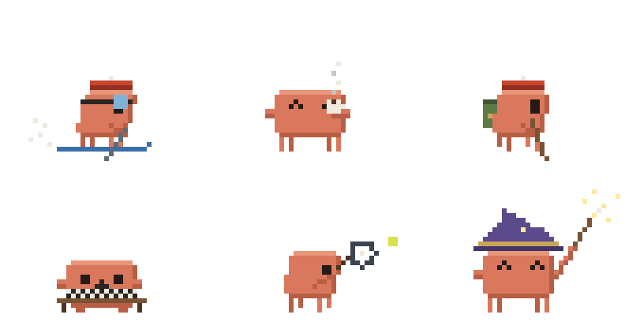

# Activity system at scale

How Clawd ends up skiing, making coffee, hiking, playing chess or tennis, casting spells and many more things, each fitting the wallpaper it's in and interacting with it, without every new activity becoming a large one-off project.

Status: design (2026-11-19). It extends PLAN.md section 4.7 and the rig prototype in `assets/clawd/design/clawd.lua`.

## The problem

Each activity needs three things:

1. **Art**: Clawd in new positions (side-on while skiing, sitting at a chess board, arm raised with a wand), holding things, sometimes in costume.
2. **A place**: a slope to ski down, a table for chess, flat ground for tennis.
3. **Interaction**: the scene responds: ski tracks in the snow, steam from a mug, sparkles from a wand, a ball that flies and bounces.

Doing all three by hand per activity doesn't scale past a dozen. The design splits each into **reusable parts**, so an activity is mostly configuration plus a short choreography.

## 1. Art: a character rig, not hand-drawn frames

Clawd is geometric (a block body, eye blocks, stub arms, four legs), so the art is drawn by a **rig**: code that draws the character from a pose description. A pose has these controls:

| Control | Values | Used by |
|---|---|---|
| `facing` | `front`, `side` (side faces right; the engine mirrors for left) | skiing, hiking, tennis, walking |
| `lift` / `crouch` | body up or down; legs stretch or bend to keep the feet planted | breathing, jumping, skiing |
| `lean` | upper body shifted forward or back by n px | skiing, running, pushing |
| `sit` | body lowered onto a seat; legs forward or hidden | chess, reading, fishing |
| `eyes` | `open`, `closed`, `left`, `right`, `up`, `happy`, `focus` | everything |
| `arm_l`, `arm_r` | `rest`, `up`, `out`, or a **hand position** `{dx, dy}`; the arm is drawn from the shoulder to the hand | holding anything anywhere |
| `hold` | an item drawn from the hand: `wand`, `racket`, `ski_pole`, `mug`, `walking_stick`, `chess_piece`, ... with an angle | most activities |
| `costume` | `wizard_hat`, `beanie`, `goggles`, `backpack`, `scarf`, ... drawn relative to the head or body | themes and seasons |
| `legs` | `stand`, `walk_a`, `walk_b`, `crouch`, `ski`, `jump`, `sit` | movement |

Anchors (`origin`, `head`, `hand_l`, `hand_r`, `item_tip`, `seat`) come out of the rig automatically, so effects and props always line up with the art.

The rig prototype already draws the six key poses (from `assets/clawd/design/_template_poses.lua`): ski, coffee, hike / chess, tennis, wizard.



**Held items are drawn as code** (lines, small ellipses, pixel maps), so they can point in any direction. Pixel-art rotation of bitmaps looks bad, but an item made of lines redraws cleanly at any angle.

**Costumes are layers**, not new characters. A wizard hat is one function that draws on top of the head anchor in every frame, so "wizard" works with every existing pose.

**A state is a short choreography**: a list of poses with durations. For example, tennis `swing`:

```lua
{ "swing", {
  f(100, { facing = "side", arm_r = { -4, -6 }, hold = { "racket", 135 } }), -- wind-up
  f(80,  { facing = "side", arm_r = { 2, -3 },  hold = { "racket", 45 }, lean = 1 }),
  f(80,  { facing = "side", arm_r = { 6, -2 },  hold = { "racket", 0 },  lean = 1 }), -- contact
  f(140, { facing = "side", arm_r = { 4, 2 },   hold = { "racket", -45 } }),          -- follow-through
} }
```

**Canvas per activity**: 24 x 20 is the base. Activities with long items use larger canvases (skis 40 x 24, tennis 40 x 32). The `origin` marker keeps every canvas aligned on the feet.

**Budget**: about 20-40 frames per activity, at most 16 character colours in total (body, shadow, highlight, eyes, plus shared costume colours), item and costume colours from a shared prop palette (scene palette budget, PLAN.md section 4.5).

## 2. Place: capabilities and set pieces

Activities already declare capabilities (`terrain`, `surface`, `time_of_day`, `weather`) instead of naming archetypes. Two additions keep the archetype list short:

- **Set pieces belong to the activity, not the archetype.** Chess brings its own table and board, coffee brings a little stand or a camp stove, painting brings an easel, tennis brings a practice wall or a net. A set piece only needs **flat ground**, so most cozy activities fit most archetypes (a ledge, a rooftop, a meadow, a pier).
- **Archetypes expose features**: platform surfaces, **slope polylines** (from the same silhouette noise as the landscape, so Clawd skis *on* the generated slope), water lines, open ground width. Activities query them (`requires.terrain = ["slope"]`, `requires.space = "wide"` for tennis).

New archetypes follow activity groups:

| Archetype | Unlocks |
|---|---|
| `snowfield`, `mountains` (slope) | skiing, sledding, snowman, hiking |
| `meadow` / park (wide flat ground, grass) | tennis, kite, picnic, hiking |
| `shore` (water line, pier) | fishing, skipping stones, rowing, surfing |
| `interior`: a cozy room whose **window shows a generated landscape** (any other archetype, rendered small) | coffee, chess, reading, coding, wizard study |
| `city_rooftops`, `desert`, `cave`, `forest`, `night_sky` | as in PLAN.md section 4.2 |

The `interior` archetype is the multiplier: every outdoor archetype also becomes the view from a window, so cozy indoor activities get as much variety as outdoor ones.

## 3. Interaction: a small library of effect types

Interaction comes from a **fixed set of effect types**, each implemented once in the engine and parameterised per activity. All are deterministic and periodic, like the ember plume.

| Type | What it does | Examples |
|---|---|---|
| `particles` at an anchor | glyph particles from a point on the character or a prop, following it every frame | wand sparkles (`*` `+` `'`), mug steam (`~` `'`), snow spray at the skis, music notes from a guitar, `z` for sleeping, hearts |
| `trail` | marks written into the glyph grid along the motion path, baked into the background | ski tracks `=`, footprints `.` `:` in snow or sand, a boat wake |
| `projectile` | an object on a periodic arc between two points, with an impact puff | tennis ball against a wall, skipped stones, snowballs, a thrown stick |
| `prop_anim` | a set piece's own frames, on its own timer or tied to a state | chess piece moving, coffee machine dripping, page turning, a bobbing float |
| `light` | a light source at an anchor or prop; uses the existing glow bands | lantern, wand glow, a desk lamp, a candle |
| `ground_mark` | a static mark under or around the focal group | rune circle under a wizard, picnic blanket, chalk court lines |
| `scene_hook` | a change to the landscape glyphs in a radius | frost spreading from a spell, flowers along a trail, ripples on a water line |

An activity combines them:

```toml
# wizard_magic.toml (sketch)
[character]
canvas = [32, 28]
costume = ["wizard_hat"]

[props.wand]
attach = "hand_r"            # held: drawn by the rig, tip exported as `item_tip`

[[effects]]
type = "particles"
preset = "sparkles"
at = "item_tip"
states = ["cast"]

[[effects]]
type = "ground_mark"
preset = "rune_circle"
states = ["cast"]

[[effects]]
type = "light"
at = "item_tip"
strength = 0.4
```

```toml
# tennis.toml (sketch)
[requires]
terrain = ["flat"]
space = "wide"
time_of_day = ["morning", "noon", "golden_hour"]

[props.practice_wall]
attach = "stage_far"         # set piece placed away from the character

[[effects]]
type = "projectile"
preset = "tennis_ball"
from = "item_tip"            # racket head at contact
to = "practice_wall"
period_from_state = "swing"  # one hit per swing
```

**Live versus GIF**: live mode plays the state machine freely (seeded variations, PLAN.md section 4.4). Periodic effects (particles, projectiles, prop animations) loop on the scene's loop length, so GIF export stays seamless. Moving lights are static in v1 (glow is baked); the live GPU path can animate them later.

## 4. Schema additions (activity TOML)

| Key | Meaning |
|---|---|
| `[character] canvas = [w, h]` | sheet canvas for this activity |
| `[character] costume = [...]` | costume pieces worn in this activity (also seedable variants) |
| `props.<id>.attach` | adds `hand_l`, `hand_r` (held, follows anchors), `stage`, `stage_left`, `stage_right`, `stage_far` (set pieces) to the existing values |
| `[[effects]]` | `type`, `preset`, `at` (anchor or prop id), `states`, parameters |
| `requires.space` | `narrow` (default) or `wide` |
| `variants` | seeded alternatives: costume colour, item style, side, e.g. a red or green scarf |

Validation (CI) grows with it: every `at` anchor exists on every frame of the listed states, every preset exists, and the canvas fits the scene's focal area.

## 5. Content waves

Each wave adds one engine capability and the activities it unlocks. Waves map onto the milestones.

| Wave | Engine capability | Activities | Milestone |
|---|---|---|---|
| A | Frames by state, anchor `particles`, held items, `light` | warming hands, wizard magic, making coffee (camp stove), reading by a lantern, guitar | M3 |
| B | Set pieces with `prop_anim`, `sit` pose, `ground_mark` | chess, painting at an easel, tea or coffee table, picnic, fishing off a ledge | M3/M4 |
| C | `path` motion on slopes and trails, `trail` effect | skiing, sledding, hiking, sandboarding, strolling a shore | M4 |
| D | `projectile` | tennis, skipping stones, snowball throwing, kicking a ball | M4 |
| E | `fly` and `bob` motion | broom flight (wizard), kite, hot-air balloon, rowing | M4 |
| F | `interior` archetype with a window view | coffee at a counter, chess indoors, coding at a desk, the wizard's study | M4+ |
| G | Seasonal and celebration sets, more costumes | snowman, fireworks, birthday cake, leaf piles | ongoing |

Every activity is weighted equally by default, and the variety test (no activity above twice its share) keeps any one from dominating as the catalogue grows.

## 6. Workflow for adding an activity

1. Write `crates/scene/activities/<id>.toml`: requirements, motion, props, states, effects, unattended props.
2. Write `assets/clawd/design/<id>.lua`: one choreography per state, using the rig.
3. Add any new held item, costume piece or set piece to the shared libraries (drawn as code).
4. `python scripts/export_sprites.py --build <id>`.
5. Review: `clairlune-cli contact-sheet --activity <id>` renders the activity in several seeds and both themes on one image (to build in M4).
6. `cargo test`: catalogue validation, sheet validation (every state has a tag, every effect anchor exists), golden images, variety test.

Most activities touch only steps 1, 2, 4 and 5.

## 7. Legal reminder

Every pose, item and costume is drawn from scratch by this project. Costumes must not copy other franchises' character designs (a generic pointed wizard hat, not a specific film's). See PLAN.md section 15.
